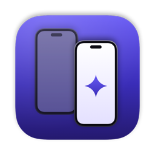
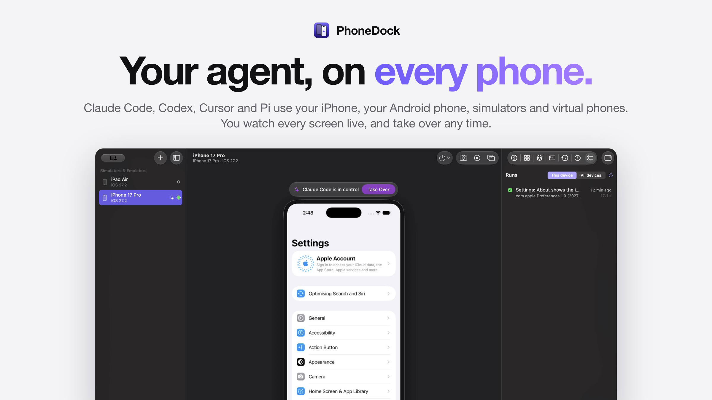
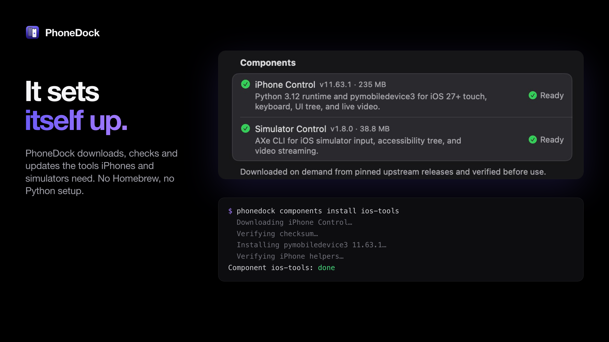
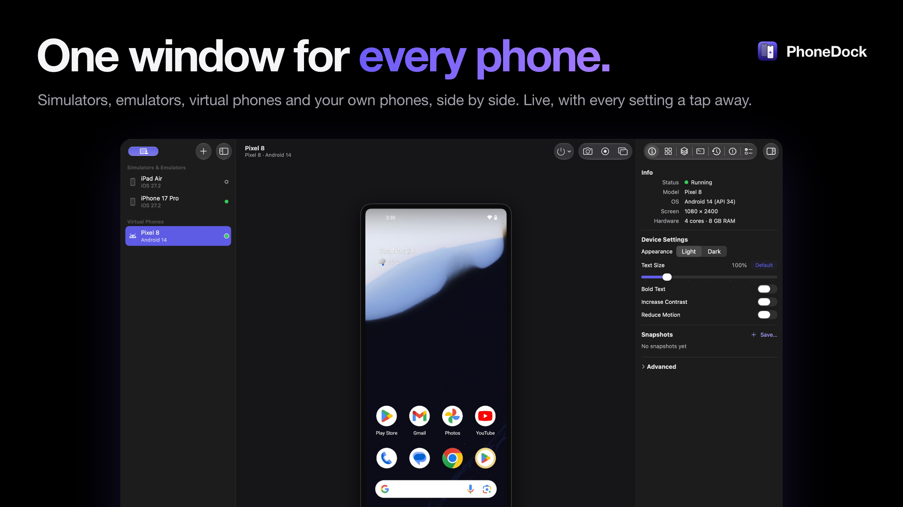
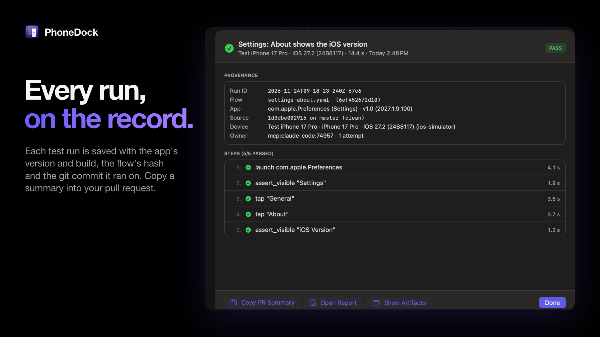

# PhoneDock

**Let your AI agent use a real phone.**

PhoneDock is a free, open-source Mac app that connects Claude Code, Codex, Cursor and Pi to iPhones, Android phones, simulators and emulators. Watch what your agent does live and take over whenever you want.

[**Download for Mac**](https://github.com/sushilk1991/phonedock/releases/latest) · [Watch the 47-second demo](https://sushilk1991.github.io/phonedock/#film) · [Website](https://sushilk1991.github.io/phonedock/)

## Get started

1. **Install PhoneDock.** Download the `.dmg` and drag PhoneDock into Applications.
2. **Connect your agent.** In PhoneDock, click **Connect an Agent…**, then **Set Up** next to your agent.
3. **Add a device.** Plug in your phone or use **Add Device** to connect wirelessly or create a simulator or emulator. Start a new agent session and try: “Use PhoneDock to open Settings on my phone and tell me what’s on screen.”

### What you need

| Device | Setup |
| --- | --- |
| iPhone on iOS 27 or later | Xcode and [one-time pairing](docs/IPHONE-WIFI.md). USB or Wi-Fi. Nothing to install on the phone. |
| Android phone | Android SDK tools. USB debugging or wireless debugging. |
| iOS simulator | Xcode. Use a simulator build of your app, not the App Store version. |
| Android emulator | Android SDK and an emulator image. [Virtual phones are in beta](docs/VIRTUAL-PHONES.md). |
| iPhone on iOS 26 or earlier | Press **Set Up Control** once per start: PhoneDock builds WebDriverAgent and keeps it private to this Mac ([beta](docs/IPHONE-WIFI.md#ios-26-and-older-webdriveragent)). |

PhoneDock requires **an Apple silicon Mac with macOS 15 or later**. The first time you use iPhone control on iOS 27 or later, or need simulator controls, PhoneDock downloads the tools automatically. Keep the Mac online for first setup. On a supported iPhone, live video starts when the tools are ready. Check progress or retry in **Settings → Advanced → Components**.

## What you can do

- **Test an app on a real phone.** Ask your agent to try a new flow, check what broke and capture screenshots for a bug report.
- **Work in apps without a web version.** Have your agent inspect a screen or collect information. You can see its taps and swipes as they happen.
- **Take over for sensitive steps.** When the agent asks you to sign in or use Face ID, take over and hand the device back when you’re done.
- **Replay a test.** Save a flow, run it again after a change and share the result from the **Runs** tab. [Run tests in CI](docs/CI.md).
- **Keep your Mac fast.** An emulator nobody has used for a while can go to sleep and free its memory (**Settings → General**). It wakes the next time you or your agent use it, usually right where it left off; otherwise it restarts with its apps and data.

## Privacy

PhoneDock has no telemetry. It can go online to check for updates, download files you request and set up device tools automatically. You can [turn off automatic device-tool downloads](docs/IPHONE-WIFI.md#ios-27-and-later). Your agent’s model provider can see screenshots your agent sends it.

[Agent setup and tools](docs/AGENTS-GUIDE.md) · [API and SDKs](docs/API.md) · [Build from source](CONTRIBUTING.md) · [Apache 2.0 license](LICENSE)
