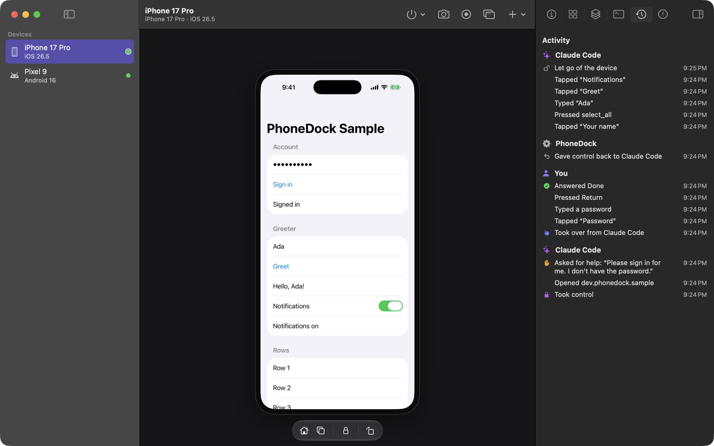

# PhoneDock

PhoneDock is a free Mac app that lets coding agents like Claude Code, Codex, Cursor and Pi use Android emulators,
iOS simulators and real phones. You watch every screen live, and you can take over at any point.

[Website](https://sushilk1991.github.io/phonedock/) · [Download](../../releases/latest) · Apple silicon, macOS 15 or later · Apache-2.0



## Quick start

You need Xcode for iPhone simulators, or the Android SDK for Android emulators ([requirements](#requirements)).
PhoneDock shows what's ready and what's missing, with the command that fixes it.

1. **Install.** Download `PhoneDock-<version>.dmg` from the [latest release](../../releases/latest) and drag
   PhoneDock to Applications. It's signed and notarized by Apple. To build it yourself, see
   [CONTRIBUTING.md](CONTRIBUTING.md).
2. **Connect your agent.** Open PhoneDock, click **Connect an Agent…**, then **Set Up** next to Claude Code, Codex,
   Cursor or Pi. Or run it in Terminal:

   ```sh
   /Applications/PhoneDock.app/Contents/Resources/bin/phonedock setup
   ```

   For every client it finds, setup registers PhoneDock's MCP server (user scope, so it works in every project),
   installs the `phonedock` agent skill and links `phonedock` into a folder on your PATH (if none can take a link, it
   gives you the line for your shell profile; agents use the full path, so they work either way). Then it checks
   each step and tells you what to fix if one fails. It never replaces settings it didn't write: it reports them
   instead, and it backs up every file it changes. `--dry-run` shows the exact changes first; `--uninstall` takes them out again.
3. **Ask your agent.** Start a new session and try: "Use PhoneDock to create an iPhone simulator, open Settings and
   turn on Dark Mode."

## What you can do

- **Create devices** from real system images: Android emulators and iOS simulators, with snapshots and clones.
- **Watch live** while an agent works, in the app or in a separate window.
- **Take over and hand back** at any time. While you hold a device, agents wait.
- **Hand off** the steps only a person should do — Face ID, sign-ins, CAPTCHAs, payments. The agent asks, you
  act, it carries on. If you're in another app, a notification asks you, with Take Over, Done and Can't Do It.
- **Inspect** the UI tree, logs (coloured by level, for one app or all), crashes, installed apps and every action
  an agent took.
- **Record** the screen to an `.mp4`, or save a screenshot. What you capture in the app goes where macOS saves
  your own screenshots (the Desktop unless you changed it in the Screenshot app's Options), named like
  `Pixel 9 2026-11-04 at 14.02.11.png`. Recordings an agent starts stay in PhoneDock's data folder; the agent is
  told the path.

## Supported devices

| Device | Status | Notes |
|---|---|---|
| Android emulator | ✅ | Android SDK emulator, Google APIs and Play Store images |
| iOS simulator | ✅ | Simulator-built apps only |
| Android phone | ✅ | USB, or Wi-Fi with wireless debugging |
| iPhone on iOS 27 or later | **Beta** | USB or Wi-Fi with no app on the phone: screen, input and UI tree. [Setup](docs/IPHONE-WIFI.md) |
| iPhone on iOS 26 or earlier | **Beta** | Needs WebDriverAgent on the phone. [Setup](docs/IPHONE-WIFI.md#ios-26-and-older-webdriveragent) |

Generic OS images (QEMU) and Corellium cloud devices are experimental; see
[docs/ARCHITECTURE.md](docs/ARCHITECTURE.md#experimental-backends).

## Connect an Android phone over Wi-Fi

1. On the phone, turn on Settings › Developer options › Wireless debugging, then tap **Pair device with pairing code**
   and keep that screen open.
2. In PhoneDock choose **Connect a Phone › Android**. Your phone appears in the list (or run
   `phonedock discover --android`). If it doesn't, **Use a QR code instead** shows a code to scan from the phone's
   Pair device with QR code, and **Enter an address** takes the IP address and port the phone shows.
3. Type the six-digit code next to the phone and click **Pair**, or run `phonedock pair 123456`.
4. That's it: PhoneDock connects and the phone shows up in the sidebar. Next time, if the phone is already paired,
   click **Connect** (or run `phonedock connect`).

If macOS blocks it, PhoneDock says why. Either turn on PhoneDock in System Settings › Privacy & Security ›
Local Network, or click **Restart adb and Try Again** (CLI: `--restart-adb`; it briefly disconnects other tools that
use adb, such as Android Studio).

## For agents

- **MCP:** `phonedock mcp` (stdio) or `phonedock mcp --http <port>`. `phonedock setup` registers it with Claude
  Code, Codex, Cursor and Pi. Manual setup for other clients, the tool list and the recommended agent loop are in
  [docs/AGENTS-GUIDE.md](docs/AGENTS-GUIDE.md).
- **Skill:** [skills/phonedock](skills/phonedock/SKILL.md) teaches an agent the fast loop (read the screen, act by
  text, check), when to take a screenshot, batching, handoffs and leases, plus recipes for PR evidence, crashes,
  dark mode and App Store screenshots. `phonedock setup` installs it in `~/.claude/skills` and `~/.agents/skills`.
- **CLI:** `phonedock` lives inside the app at `PhoneDock.app/Contents/Resources/bin/phonedock`;
  `phonedock setup` links it onto your PATH when it can.

  ```sh
  phonedock create --backend android-emulator --name Pixel --profile pixel_9 --boot
  phonedock ui Pixel                    # accessibility outline with refs: e12 Button "Settings" @(540,1210)
  phonedock tap Pixel --text "Settings"
  phonedock screenshot Pixel -o shot.png
  ```

- **SDKs:** TypeScript ([src/sdk](src/sdk/index.ts)) and Python ([sdk/python](sdk/python/README.md)). The HTTP
  API is in [docs/API.md](docs/API.md).

## From exploration to regression test

Ask your agent to test a flow once, save it, and run it on every PR.

1. The agent does the task on a device ("open the sample app, greet Ada, turn notifications on") and then calls
   `save_flow` — or you run `phonedock flow save <device> -o flows/greet.yaml` afterwards. PhoneDock turns what it did
   into a readable file. Text taps become text selectors and fills stay one step. Retries, timed-out waits and undone
   taps are left out, and checks are added for the first screen and the last:

   ```yaml
   name: Greet Ada and turn on notifications
   appId: dev.phonedock.sample
   platform: android
   minOS: "16"
   steps:
     - launch: dev.phonedock.sample
     - assert_visible: PhoneDock Sample
     - fill: { field: Your name, value: Ada }
     - tap: Greet
     - wait_for: { visible: "Hello, Ada!" }
     - tap: { text: Notifications, type: Switch }
     - assert_visible: Notifications on
   ```

2. `phonedock test flows/ --device <id> --junit junit.xml` replays it: PASS/FAIL per step with timings. It waits for
   each element and lets the screen settle between steps. Exit code 0 only if everything passed. A failure says
   what was expected and what was on screen, and saves a screenshot, the UI tree and recent logs.
3. Run the same command in CI on a macOS runner: [docs/CI.md](docs/CI.md). `phonedock flow export --maestro` writes a
   Maestro version of a flow. The format, the conversion rules and the runner are in [docs/API.md](docs/API.md#flows).

## Requirements

- A Mac with Apple silicon (M1 or later) on macOS 15 or later.
- **iOS simulators:** Xcode, plus [AXe](https://github.com/cameroncooke/AXe) for input and the UI tree
  (`brew install cameroncooke/axe/axe`).
- **Android:** the Android SDK command-line tools and emulator (`brew install --cask android-commandlinetools`).
  `scrcpy` and `ffmpeg` are optional (separate windows, recording, live streaming).
- **iPhones:** Xcode and `pymobiledevice3` (`uv tool install pymobiledevice3`).
- **Node.js:** PhoneDock.app includes its own runtime. Running from source needs Node.js 24 or later.

`phonedock backends` shows what's available on your Mac and what's missing.

## Privacy and security

- The PhoneDock service listens on `127.0.0.1` only. Every request needs a token that's stored in your user
  account's PhoneDock data folder (`~/Library/Application Support/PhoneDock`).
- macOS may ask for **Local Network** access when PhoneDock connects to a phone over Wi-Fi; that's what lets it
  reach phones on your network. Simulators, emulators and USB phones don't need it.
- There's no telemetry. PhoneDock goes online only for things you ask for: downloading system images or
  WebDriverAgent, mounting an iPhone's developer disk image, or a cloud backend you configure.
- Leases keep agents from colliding: while one agent or you hold a device, input from anyone else is refused. An
  agent's lease ends when its session ends, when its process exits, or after 10 minutes unused; yours lasts until
  you hand the device back.

## Limitations

- App Store apps can't run in the iOS simulator; use a real iPhone for those.
- iPhone support is Beta. On iOS 27 or later, only one app can show the phone's screen at a time, so close Xcode's
  device window or iPhone Mirroring first. On older iOS, WebDriverAgent must be rebuilt every 7 days with a free
  Apple ID.
- Restarting the PhoneDock service clears leases. Devices keep running.
- On Android, PhoneDock reads the screen's elements through UiAutomation, which allows one client at a time. While
  you run your own UiAutomator or Espresso tests on the same device, set `PHONEDOCK_ANDROID_HELPER=0`.

## Build from source

See [CONTRIBUTING.md](CONTRIBUTING.md).

## License

[Apache-2.0](LICENSE)
